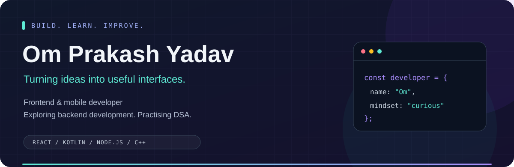
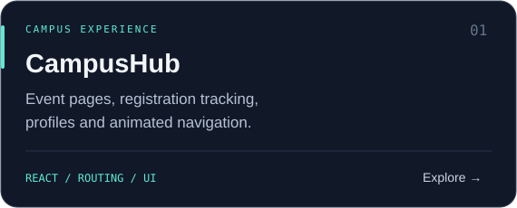
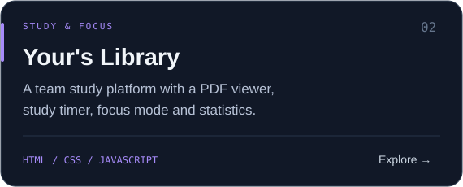
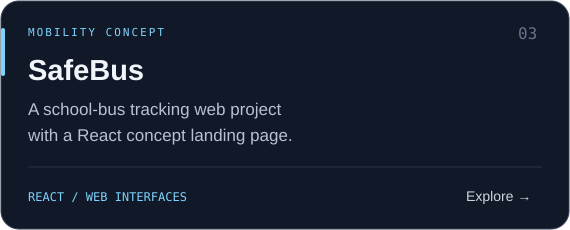
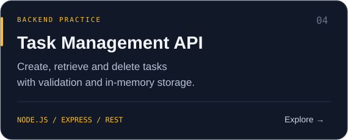

<b>Thoughtful interfaces. Practical projects. Continuous learning.</b> 
I build web experiences, explore Android development, and strengthen my problem-solving skills one project at a time.

 

## ✦ Selected work

Student life, focused study, and everyday tools — a few ideas I've been building.

<table>
<tr>
<td width="50%"></td>
<td width="50%"></td>
</tr>
<tr>
<td width="50%"></td>
<td width="50%"></td>
</tr>
</table>

<a href="https://github.com/Om-Prakash0/AndroidPlaylistDemo">Android projects</a> &nbsp; · &nbsp; <a href="https://github.com/Om-Prakash0/dailyLearning">Daily learning</a> &nbsp; · &nbsp; <a href="https://github.com/Om-Prakash0?tab=repositories">Browse all repositories →</a>

 

## ◈ My toolkit

 

<table>
<tr><td width="50%" valign="top">

### Build & create
**Frontend:** React, JavaScript, HTML, CSS, Tailwind CSS  
**Mobile:** Kotlin, Android Studio  
**Backend practice:** Node.js, Express

</td><td width="50%" valign="top">

### Solve & explore
**Programming:** C, C++, Python  
**Databases:** MySQL, MongoDB  
**Tools:** Git, GitHub, VS Code, Google Colab

</td></tr>
</table>

 

## ↗ Learning in progress

- **Better interfaces** — responsive layouts, clear navigation, and thoughtful interactions.
- **Connected applications** — bringing frontend features and backend APIs together.
- **Mobile development** — understanding Android app flows through hands-on projects.
- **Stronger foundations** — data structures, algorithms, and consistent practice.

 

<b>🟡 A playful look at my contributions</b>

 
<picture>
<source media="(prefers-color-scheme: dark)" srcset="https://raw.githubusercontent.com/Om-Prakash0/Om-Prakash0/output/pacman-contribution-graph-dark.svg" />
<source media="(prefers-color-scheme: light)" srcset="https://raw.githubusercontent.com/Om-Prakash0/Om-Prakash0/output/pacman-contribution-graph.svg" />

</picture>

---

### Let's connect and share ideas.

[LinkedIn](https://www.linkedin.com/in/om-prakash-yadav-122499313/) &nbsp; / &nbsp; [Topcoder](https://profiles.topcoder.com/om0049) &nbsp; / &nbsp; [X](https://twitter.com/om_0049)

Build with curiosity. Improve with practice.

